# Product Management & Visualization

This directory contains product-centric documentation, progress tracking, and auto-generated visual artifacts for stakeholder communication.

---

## 📊 Visual Artifacts

LXI automatically generates visual diagrams during the sync cycle to keep product stakeholders informed. All diagrams are defined in **Mermaid** format (`.mmd` files) and converted to SVG/PNG for embedding.

### Generated Visuals

| Visual | Source | Generated | Purpose |
|--------|--------|-----------|---------|
| **Roadmap** | `roadmap.mmd` | `roadmap.svg` | High-level timeline of epics and milestones |
| **Outcomes Dashboard** | `outcomes.mmd` | `outcomes.svg` | Progress toward business outcomes/OKRs |
| **Epic Dependencies** | `epic-dependencies.mmd` | `epic-dependencies.svg` | Cross-epic and cross-team dependencies |
| **Team Capacity** | `team-capacity.mmd` | `team-capacity.svg` | Team allocation and availability |
| **Feature Progress** | `feature-progress.mmd` | `feature-progress.svg` | Feature completion status |

---

## 🗺️ Roadmap

### File: `roadmap.mmd`

Gantt-style roadmap showing epic timelines, milestones, and current progress.

**Auto-generated from**:
- LX Documents (`process/lx/*.md`)
- Jira Epic dates and status
- Milestones defined in `product/goals.yml`

**Example Mermaid**:
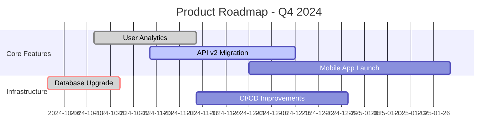

**Regenerate**: `./gradlew generateRoadmap`

---

## 🎯 Outcomes Dashboard

### File: `outcomes.mmd`

Visual representation of progress toward business outcomes (OKRs, KPIs).

**Auto-generated from**:
- `product/goals.yml` (defined outcomes and key results)
- LX Documents (epic progress)
- Jira Epic completion percentages

**Example Mermaid**:
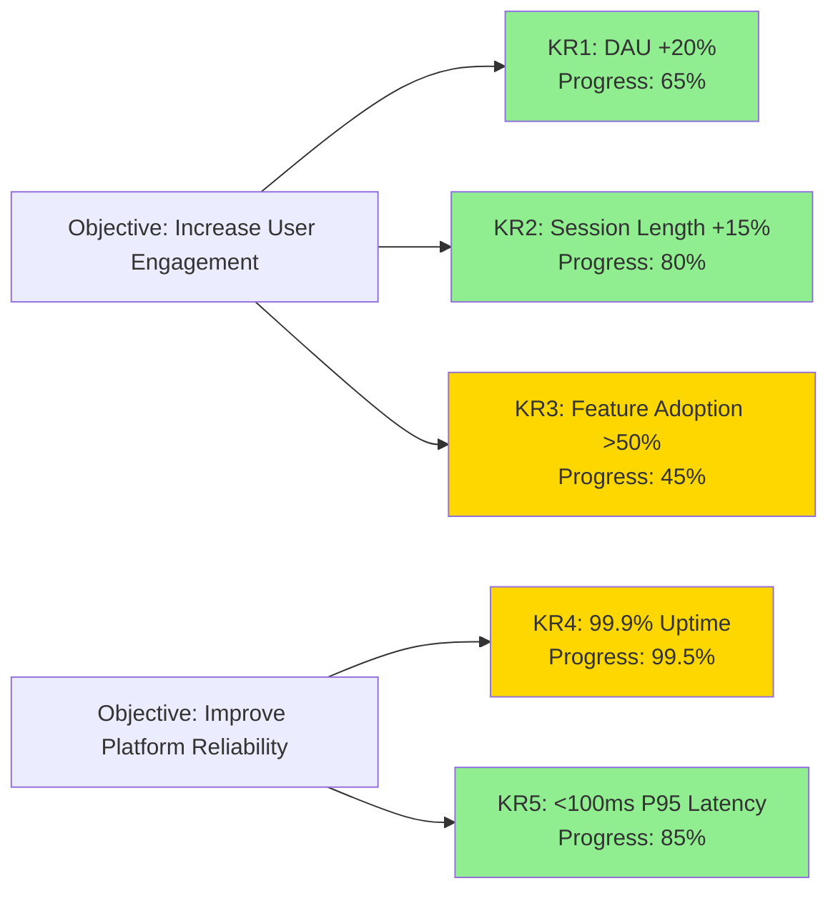

**Regenerate**: `./gradlew generateOutcomes`

---

## 🔗 Epic Dependencies

### File: `epic-dependencies.mmd`

Shows relationships and dependencies between epics across teams.

**Auto-generated from**:
- Design Reviews (dependencies section)
- LX Documents (blocker/dependency tracking)
- Jira Epic links

**Example Mermaid**:
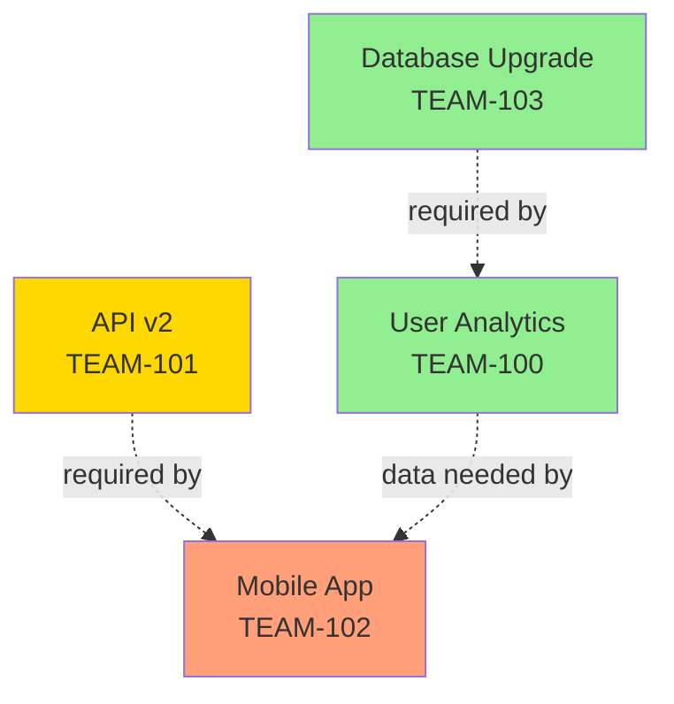

**Regenerate**: Auto-generated during `syncAll`

---

## 👥 Team Capacity

### File: `team-capacity.mmd`

Shows team member allocation across epics.

**Auto-generated from**:
- LX Documents (team assignments)
- Jira story assignments
- PTO/OOO calendar

**Example Mermaid**:
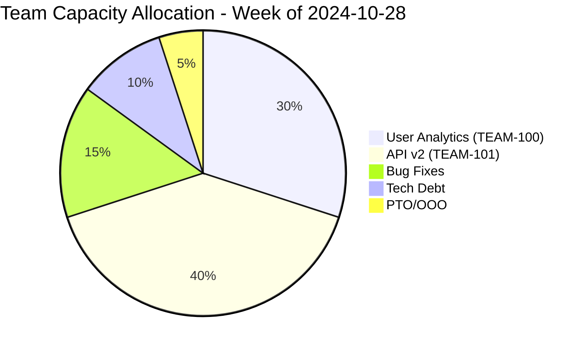

---

## 📈 Feature Progress

### File: `feature-progress.mmd`

Detailed breakdown of feature implementation progress.

**Auto-generated from**:
- Jira story completion
- LX Document epic status
- Design Review implementation tracking

**Example Mermaid**:
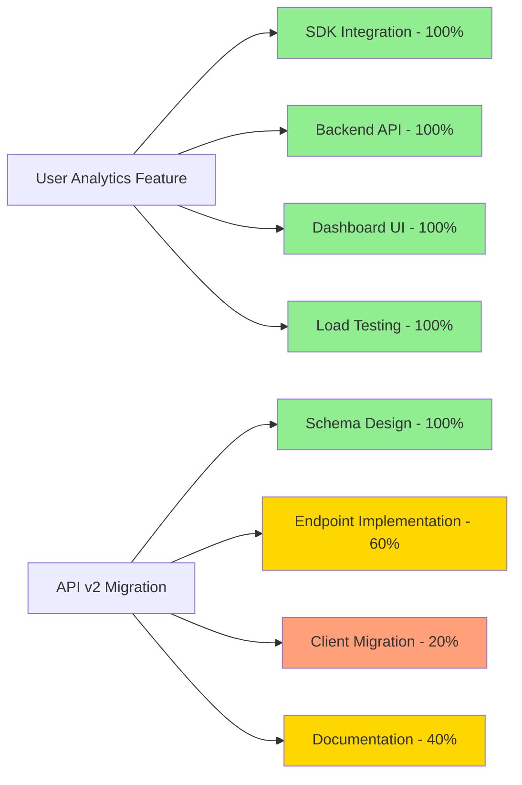

---

## 🎨 Creating Custom Diagrams

### 1. Create Mermaid Definition

Create a `.mmd` file in `product/`:

```bash
touch product/my-diagram.mmd
```

### 2. Define Diagram

Use [Mermaid syntax](https://mermaid.js.org/intro/):

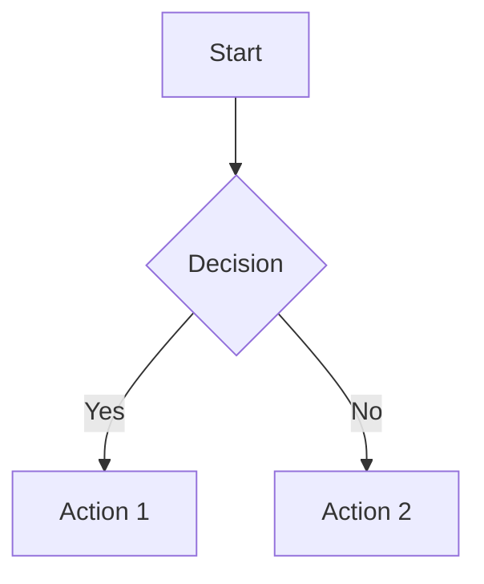

### 3. Generate SVG

```bash
./gradlew generateDiagrams
```

This creates `product/my-diagram.svg`

### 4. Embed in Markdown

```markdown

```

Or reference in Confluence/Jira after sync.

---

## 📋 Product Goals Configuration

### File: `product/goals.yml`

Define business outcomes, objectives, and key results:

```yaml
quarter: Q4 2024
objectives:
  - id: O1
    title: Increase User Engagement
    owner: Product Team
    key_results:
      - id: KR1
        description: Daily Active Users +20%
        target: 120000
        current: 105000
        unit: users
        epic: TEAM-100

      - id: KR2
        description: Average Session Length +15%
        target: 8.5
        current: 7.8
        unit: minutes
        epic: TEAM-100

  - id: O2
    title: Improve Platform Reliability
    owner: Engineering Team
    key_results:
      - id: KR3
        description: Achieve 99.9% uptime
        target: 99.9
        current: 99.5
        unit: percent
        epic: TEAM-103

milestones:
  - date: 2024-11-15
    title: User Analytics Launch
    epic: TEAM-100

  - date: 2024-12-15
    title: API v2 Beta Release
    epic: TEAM-101

  - date: 2025-01-31
    title: Mobile App Launch
    epic: TEAM-102
```

---

## 🔄 Sync Cycle

During the sync cycle (`./gradlew syncAll`), LXI:

1. **Reads** current state:
   - LX Documents
   - Jira epic/story data
   - `product/goals.yml`
   - Git history

2. **Generates** diagrams:
   - `roadmap.mmd` → `roadmap.svg`
   - `outcomes.mmd` → `outcomes.svg`
   - `epic-dependencies.mmd` → `epic-dependencies.svg`
   - `team-capacity.mmd` → `team-capacity.svg`
   - `feature-progress.mmd` → `feature-progress.svg`

3. **Updates** external systems:
   - Pushes SVGs to Confluence
   - Embeds in Jira epic descriptions
   - Updates LX Document with links to visuals

4. **Archives** previous versions:
   - Moves old diagrams to `product/archive/YYYY/MM/`

---

## 🎯 Usage Examples

### Weekly PM Review

```bash
# Generate latest roadmap and outcomes
./gradlew generateRoadmap generateOutcomes

# Open in browser (if using live server)
open product/roadmap.svg
open product/outcomes.svg
```

### Stakeholder Demo

```bash
# Generate all visuals and sync to Confluence
./gradlew syncAll

# Visuals automatically embedded in:
# - Confluence team page
# - Jira epic descriptions
# - LX Document
```

### Custom Epic View

Create `product/epic-team100.mmd`:

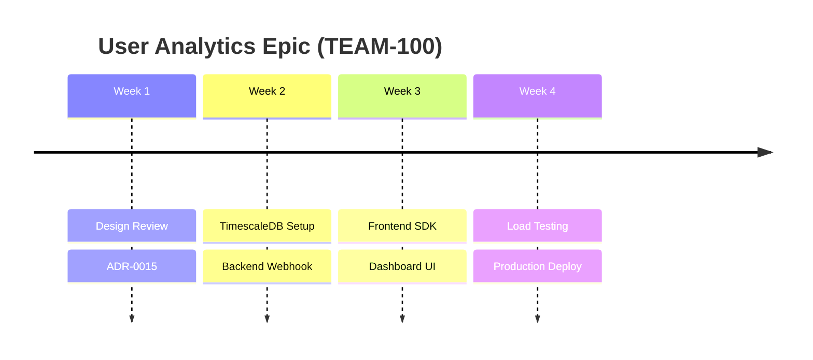

Generate:
```bash
./gradlew generateDiagrams
```

---

## 🛠️ Prerequisites

### Install Mermaid CLI

```bash
npm install -g @mermaid-js/mermaid-cli
```

Verify:
```bash
mmdc --version
```

### Configure in `user/settings.yml`

```yaml
diagrams:
  format: svg  # svg or png
  theme: neutral  # neutral, dark, forest, default
  background: transparent

sync:
  confluence:
    embed_diagrams: true
    page_id: 123456

  jira:
    embed_diagrams: true  # Embed in epic descriptions
```

---

## 📐 Diagram Types Supported

### Flowcharts
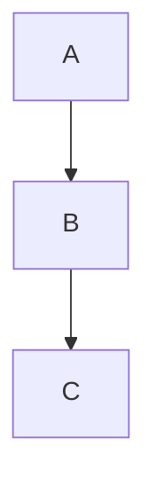

### Sequence Diagrams
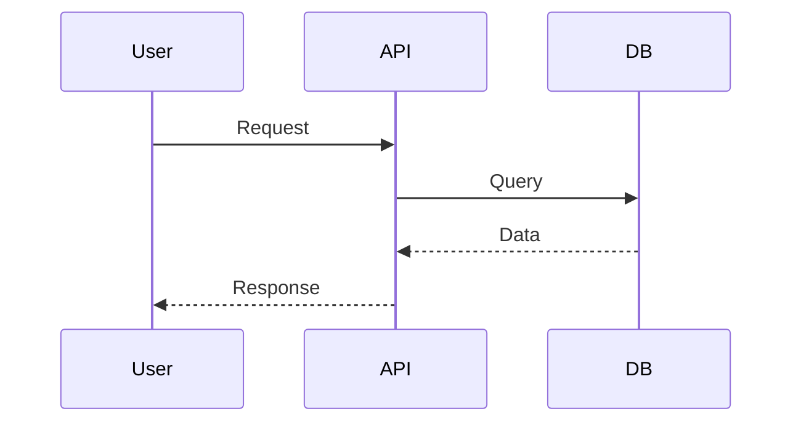

### Gantt Charts
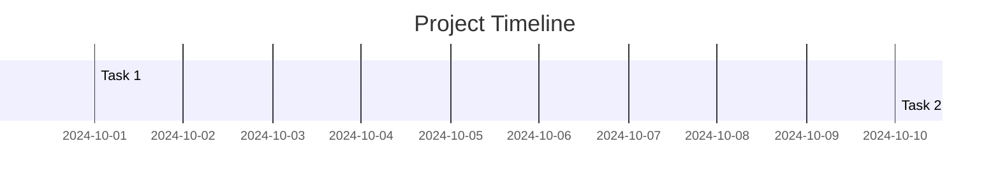

### Pie Charts
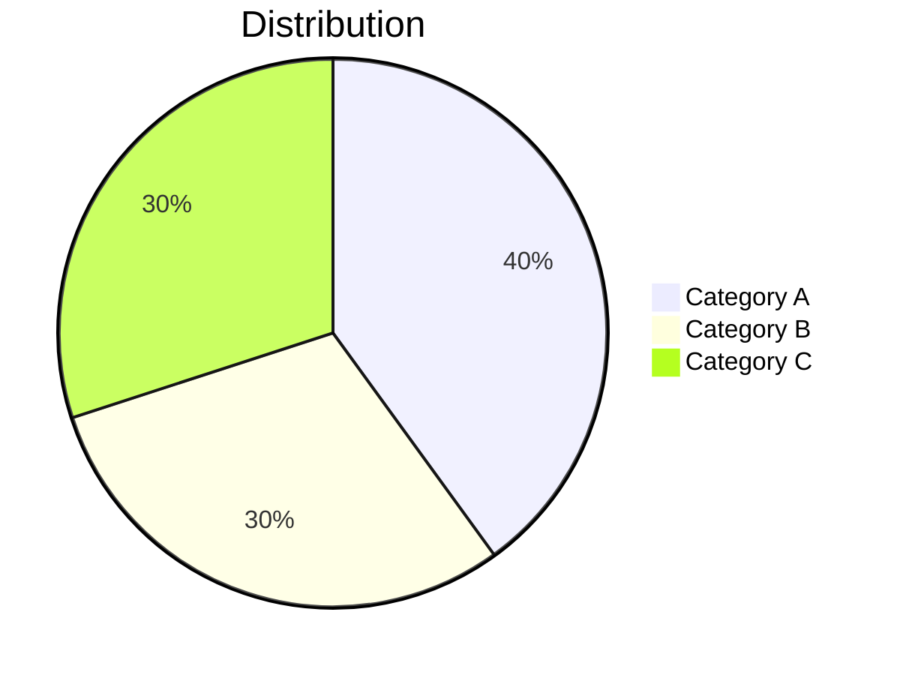

### Timeline
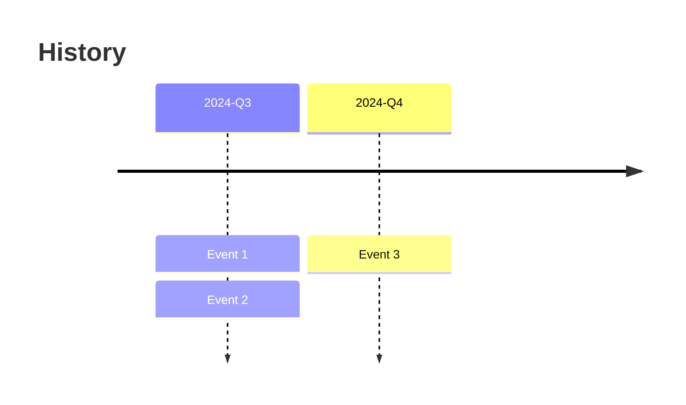

### State Diagrams
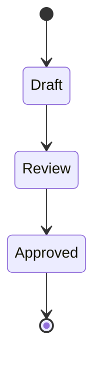

---

## 🤖 AI Agent Integration

AI agents can auto-update diagrams based on:

**Triggers**:
- LX Document updated → Regenerate roadmap
- Epic status changed → Update outcomes dashboard
- New dependency added → Refresh epic dependencies

**Commands**:
```bash
@lxi regenerate roadmap
@lxi update outcomes
@lxi sync diagrams
```

---

## 📊 Metrics & KPIs

Track diagram generation effectiveness:

| Metric | Target | How to Measure |
|--------|--------|----------------|
| Diagram freshness | < 24 hours old | Check last modified date |
| Stakeholder views | > 50/week | Confluence analytics |
| Sync success rate | > 95% | Sync logs |
| Diagram generation time | < 30 seconds | Build logs |

---

_This product visualization system is part of the LXI framework. See [ARCHITECTURE.md](../ARCHITECTURE.md) for system overview._
